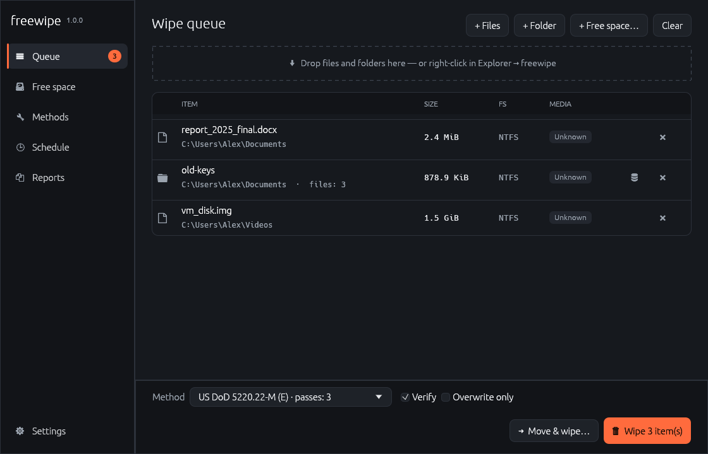
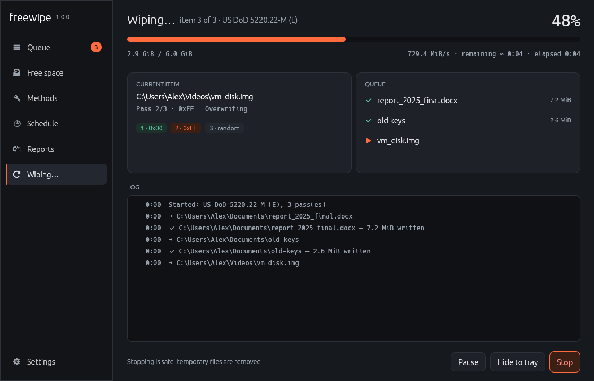
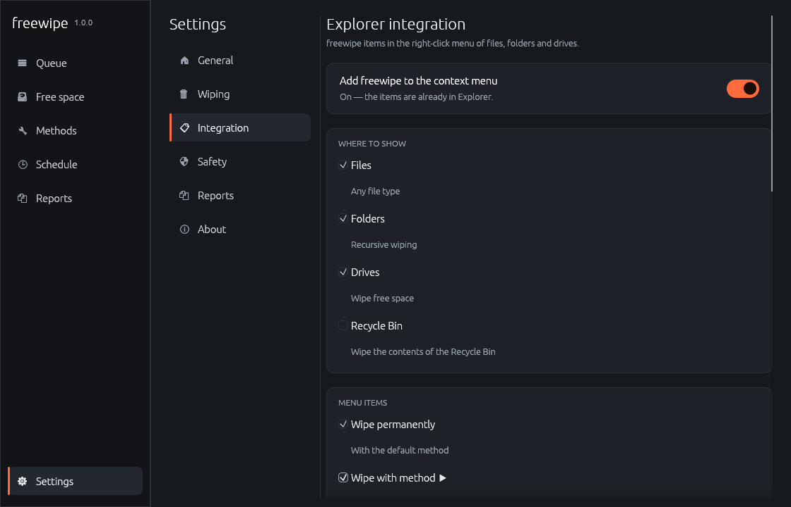

# freewipe

Lightweight, open-source secure data wiping for Windows — **files, folders, free space and the Recycle Bin** — with a command-line tool, a desktop app and Explorer context-menu integration.

| Queue | Wiping | Explorer integration |
|---|---|---|
|  |  |  |

- 19 wiping methods, from a single NIST pass to Gutmann's 35 passes
- Verification that reads the last pass back **from the disk** (unbuffered I/O, SHA-256)
- NTFS alternate data streams, read-only/hidden files, renaming before deletion
- File-system aware: FAT32's 4 GiB limit, ReFS/btrfs copy-on-write, NTFS MFT/journal warnings
- Detects SSD / NVMe / USB flash and warns honestly about what overwriting cannot do
- Protected paths (Windows, Program Files, drive roots, freewipe itself, plus your own list) unless `--force`
- Explorer context menu for files, folders, drives and the Recycle Bin (per-user or all users)
- English built in; German, Spanish, French, Polish, Russian and Ukrainian language packs included, more can be added as JSON files
- JSON reports; no network access, no telemetry

## Download contents

| File | What it is |
|---|---|
| `freewipe.exe` | Command-line tool |
| `freewipe-gui.exe` | Desktop app |
| `freewipe_shell.dll` | Explorer context-menu extension (loaded by Explorer, starts freewipe-gui) |
| `locales\` | Language packs (German, Spanish, French, Polish, Russian, Ukrainian); English is built in |

Keep the files and the `locales` folder together (e.g. `C:\Program Files\freewipe\`). The GUI uses `freewipe.exe` only for the all-users (administrator) context-menu install. When the menu is installed, the DLL is copied to `%LOCALAPPDATA%\freewipe\shell\<version>\` (all users: `%ProgramData%\…`), so Explorer never locks the copy you unpacked and the next version can replace it.

## Desktop app

Queue files by dragging them in, with the buttons, or from Explorer. Pick a method, press **Wipe**, type the confirmation word. You can pause or stop at any time; stopping is safe (free-space fill files are always removed).

**Settings → Integration** adds freewipe to the Explorer context menu:

- where: files, folders, drives (*wipe free space*), Recycle Bin
- items: *Wipe permanently*, *Wipe with method ▶* (every method), *Add to freewipe queue*, *Move to… and wipe original*
- a `freewipe ▶` submenu or separate items; optional icon; **Shift-only** mode
- *Always ask for confirmation* and *Add to the queue first* protect against accidental clicks
- current user (HKCU, no admin) or all users (HKLM, UAC prompt)
- *Export .reg…* writes the exact registry entries for review or deployment

The menu items are served by a small **shell extension** (`freewipe_shell.dll`, an `IExplorerCommand` handler). Explorer calls it directly with the whole selection; it writes the paths to a temporary list and starts `freewipe-gui.exe`. Nothing is "opened" through `ShellExecute`, so Windows runs no download/SmartScreen check: no "Open File – Security Warning" for downloaded files such as ISOs and no long busy cursor before large files. The classic command-line verbs remain selectable under *Settings → Integration → How Explorer starts freewipe* and are used automatically if the DLL is missing.

When freewipe finds menu entries from another version or another copy, it shows a banner offering **Update menu** or **Remove**.

**"Wipe permanently" from Explorer** either opens a compact window that wipes right away (default) or adds the items to the main queue — *Settings → Integration*. The compact window closes itself when everything succeeded.

**Settings → Safety:**

- *Protected locations*: the list of places freewipe refuses to wipe. Built-in entries can be turned off (and restored); add your own files or folders — typed (`%USERPROFILE%\Documents\Keep`) or picked — as "this folder and everything inside" or "exactly this path". A folder containing a protected location is refused too. Drive roots and freewipe itself are always protected. *Allow protected targets* (`--force`) bypasses the list.
- *Confirmation*: a dialog with **Wipe / Cancel** buttons (default, Enter confirms), a dialog where a word must be typed, or **no confirmation**.
- *Administrator rights*: when an item fails with "access denied", the result screen offers **Retry as administrator** for just those items (one UAC prompt). Optionally **always run freewipe as administrator**.
- *Password protection*: ask for the password **when freewipe starts**, **before Settings**, **before every wipe**, **before Schedule** (create, change, run or delete scheduled wipes), **before Methods** (custom methods) and/or **before Reports** (each switch independent). One correct password unlocks the protected pages until freewipe closes; scheduled runs never ask. Only a salted PBKDF2-SHA256 hash is stored — in `settings.json`, a separate `lock.json` and `HKCU\Software\freewipe` at once; freewipe restores missing copies from the newest one, so deleting `settings.json` does not unlock it. The optional **all-users lock** lives in `HKLM` (administrator rights to set or change) and cannot be removed by standard users. Honest limit: it is an access lock, not encryption, and nothing stops a PC administrator (who can also remove scheduled wipes directly in the Windows Task Scheduler). Wiping CLI commands ask for it too; in scripts use the `FREEWIPE_PASSWORD` environment variable.
- *Small progress window*: wipes started from Explorer show a small progress window (straight away when no confirmation is needed); after a clean run it stays open or closes after 3–30 s, as configured.
- *SSD/flash*: optionally use a single pass there (more passes only add time and wear).
- *Free space extras*: **cluster tips** — the unused end of every file's last cluster (contents, sizes and dates are kept; interrupted runs are repaired from a journal) — and **NTFS file records** — names of deleted files and deleted small files kept in the MFT. Both are options on the *Free space* page (`--cluster-tips`, `--file-records`).
- *Files in use*: freewipe shows which program holds the file and offers to close it and retry, try again, or wipe it at the next sign-in.
- *Notification-area icon* while a wipe runs (progress on hover, hide the window there, a notification when it ends). freewipe does not start with Windows or stay in the background — it has nothing to do between wipes.

**Folder filters.** The ⛃ button on a queued folder chooses which files are wiped: include masks (`*.tmp; *.log`), exclude masks (files and sub-folders) and *keep the folder itself*. With masks, folders that still hold other files are kept. CLI: `freewipe dir PATH --include "*.tmp;*.log" --exclude keep --contents-only`.

**Custom methods** (*Methods → New method*): any sequence of up to 99 passes — zeros, ones, a byte, a hex pattern (repeated) or random data — with optional verification. They appear everywhere methods do (`--method custom-<name>` in the CLI).

**Move & wipe** (queue button, context-menu item, `freewipe move PATH --to DIR`): copies to another drive, flushes and reads every file back (SHA-256), and only then wipes the originals with the chosen method; on any copy error the original is left untouched. Within the same drive it is a plain move — the data does not move on disk, so there is no old copy to wipe.

**Schedule** (Windows Task Scheduler): wipe a drive's free space (optionally with cluster tips / NTFS records), files in a folder (with masks — e.g. Temp or Downloads) or the Recycle Bin daily, weekly, monthly or at sign-in. The task runs `freewipe-gui.exe --run-schedule <id>` as you, without administrator rights, without a time limit, and catches up after a missed start; by default only the tray icon and a notification are shown. No password or confirmation is asked for scheduled runs — you authorised them when creating them.

**Debug log** (*Settings → General → Diagnostics*, or set `FREEWIPE_DEBUG_LOG=1` for the CLI): records every action — requests from Explorer, options, each target's result and engine notes, refusals, Task Scheduler and context-menu changes, errors — in `%LOCALAPPDATA%\freewipe\logs\`. The Explorer extension writes `shell.log` there. The log contains paths and stays on your PC; passwords are never written. Attach it when reporting a problem.

**Reports**: open, delete one, *Delete all* (normal deletion) or *Wipe all* (wiped like any file; no report is written about it). Redacted reports also hide the paths of files in use and move destinations.

## "Windows protected your PC" (SmartScreen)

The blue/purple SmartScreen window appears for any downloaded program that is **not code-signed** and not yet known to Microsoft. freewipe is safe to run anyway (*More info → Run anyway*), but to make the warning go away:

- **For yourself:** right-click the `.exe` → *Properties* → tick **Unblock** → OK (or PowerShell: `Unblock-File .\freewipe*.exe`). Programs you build yourself with `cargo build` never get the mark and never show the warning.
- **For distribution:** sign the executables with an Authenticode certificate (OV certificate from a CA, Azure Artifact Signing, or SignPath Foundation's free signing for open-source projects). Even signed files can show the warning until they build reputation; it fades as the same publisher signs releases and people run them. Publishing through the Microsoft Store avoids it completely.

> **Windows 11:** classic registry menu items appear under *Show more options* (Shift+F10). Showing freewipe in the compact top-level menu requires a packaged `IExplorerCommand` shell extension, which is planned.

## Command line

```
freewipe <COMMAND> [OPTIONS]

Commands:
  file         Wipe one or more files
  dir          Wipe folders recursively
  freespace    Wipe the free space of a volume
  recycle-bin  Wipe the contents of the Recycle Bin
  methods      List all wiping methods
  shell        Explorer context-menu integration (install | uninstall | status | export)

Options:
  -m, --method <KEY>       Wiping method [default: dod-e]
  -p, --passes <N>         Number of passes for random / randomN
      --verify             Verify the last pass by reading it back from the disk
      --no-verify          Never verify, even if the method's standard requires it
      --rename-passes <N>  How many times to rename before deleting [default: 3]
      --keep               Overwrite only; do not rename or delete
      --no-ads             Skip NTFS alternate data streams
      --buffer <MIB>       I/O buffer size in MiB (1–64) [default: 4]
  -l, --lang <CODE>        Interface language: en (default), uk, ru, …
  -n, --dry-run            Show the plan without writing anything
  -y, --yes                Do not ask for confirmation
  -q, --quiet / -v, --verbose
      --force              Allow protected targets
      --log <FILE>         Save a JSON report
```

Examples:

```bat
freewipe file secret.docx
freewipe dir C:\Users\me\old-keys -m gutmann
freewipe freespace D:\ -m random --reserve 512
freewipe freespace C:\ --cluster-tips --file-records
freewipe file report.pdf -n                     :: dry run
freewipe recycle-bin -y
freewipe shell install --shift-only             :: context menu, current user
freewipe shell install --all-users --flat       :: run as administrator
freewipe shell export -o freewipe.reg
```

Exit codes: `0` success, `1` some items failed or were skipped, `2` usage error, `130` cancelled.

Ctrl+C stops after the current buffer and removes temporary files; a second Ctrl+C quits immediately.

## Methods

| Key | Method | Passes | Scheme |
|---|---|---|---|
| `zero` | Zeroes | 1 | 0x00 |
| `one` | Ones | 1 | 0xFF |
| `random` | Random | 1 | cryptographic random (ChaCha20) |
| `random3` | Random ×3 | 3 | random |
| `randomN` | Random ×N | N (`--passes`) | random |
| `nist-clear` | NIST SP 800-88 Clear | 1 | 0x00 + verify |
| `gost` | GOST R 50739-95 | 2 | 0x00, random |
| `hmg-is5-base` | British HMG IS5 Baseline | 1 | 0x00 |
| `hmg-is5-enh` | British HMG IS5 Enhanced | 3 | 0x00, 0xFF, random + verify |
| `dod-e` | US DoD 5220.22-M (E) | 3 | 0x00, 0xFF, random + verify |
| `dod-ece` | US DoD 5220.22-M (ECE) | 7 | (E), random, random, (E) + verify |
| `army-ar380-19` | US Army AR 380-19 | 3 | random, 0x00, 0xFF + verify |
| `af-5020` | US Air Force SSI 5020 | 3 | 0x00, 0xFF, random |
| `navso-5239-26` | US Navy NAVSO P-5239-26 | 3 | 0x01, 0xFE, random + verify |
| `rcmp-ops-ii` | Canadian RCMP TSSIT OPS-II | 7 | 0x00/0xFF ×3, random |
| `vsitr` | German VSITR | 7 | 0x00/0xFF ×3, 0xAA |
| `schneier` | Bruce Schneier | 7 | 0xFF, 0x00, 5× random |
| `pfitzner` | Pfitzner | 33 | random |
| `gutmann` | Peter Gutmann | 35 | 4 random, 27 RLL/MFM patterns, 4 random |

Methods whose standard includes verification enable `--verify` automatically (`--no-verify` turns it off).

## What happens to a file

1. read-only / hidden / system attributes are cleared;
2. every stream — the main data and each NTFS alternate data stream — is overwritten pass by pass, with `FILE_FLAG_WRITE_THROUGH` and `FlushFileBuffers` after every pass;
3. with verification, the stream is re-opened with `FILE_FLAG_NO_BUFFERING` and its SHA-256 compared with what was written;
4. the file is renamed several times to random names, truncated to zero and deleted.

Folders: every file as above, links/junctions are removed without being followed, folders are renamed and removed deepest-first.

Free space: chunk files (≤ 1 GiB, < 4 GiB on FAT32) fill the volume until it is full, receive every pass, are optionally verified and then deleted — also on error or cancellation.

## Links and shortcuts

* A **symbolic link or junction** given to freewipe is removed as a link; what it points to is never overwritten.
* A **shortcut** (`.lnk`) is an ordinary small file: wiping it wipes the shortcut file, not its target. When you right-click a shortcut, Explorer may hand menu handlers the shortcut's *target*; freewipe's shell extension checks the folder's real selection and passes the shortcut itself.

## Honest limits — please read

- **SSD, NVMe, USB sticks, SD cards.** Controllers remap writes (wear-levelling) and keep spare blocks the OS cannot address. Overwriting files *cannot guarantee* physical erasure there. Use full-disk encryption (BitLocker, VeraCrypt) from the start, or the drive's ATA/NVMe Secure Erase / Sanitize for the whole disk. freewipe detects such media and warns.
- **Copy-on-write file systems** (ReFS with integrity streams or block cloning, btrfs, ZFS, APFS) may write new data to new blocks; the original blocks are not guaranteed to be overwritten.
- **NTFS MFT:** files smaller than roughly 700 bytes live inside the MFT record. They are overwritten in place, but older copies of the record (e.g. in `$LogFile`) may survive. Free MFT records are only wiped with the *NTFS file records* option; directory index entries ($I30 slack) and FAT/exFAT directory entries of deleted files are not.
- **Journal / USN journal:** file names, sizes and times may remain in the NTFS journal for a while.
- **Volume Shadow Copies, restore points, File History, backups, cloud sync** keep their own copies; freewipe does not delete them.
- **Cluster slack:** only wiped with the *cluster tips* option, and not for files that are in use, compressed, encrypted, sparse or on ReFS. The NTFS change time (not shown in Explorer) and the USN journal record the touch.
- **Network drives:** the server's snapshots, caches and RAID are out of freewipe's control.

## Building

Requires Rust 1.80+. Quick start on Windows: `cargo build --release`. Full instructions (Windows, Linux→Windows cross-compile, development builds, releases): [docs/BUILDING.md](docs/BUILDING.md).

## Adding a language

English is built in; every other language is a **language pack** — `locales/<code>.json` next to the executables (also `%APPDATA%\freewipe\locales`). Shipped: Deutsch, Español, Français, Polski, Русский, Українська. Add or remove a file and the language list follows; no rebuild is needed. The format (flat JSON, `{placeholders}`, `_name` and other metadata keys) is described in [`locales/README.md`](locales/README.md); `freewipe languages` shows what is installed and how complete each pack is, and `cargo test` checks every shipped pack against `en.json`.

## Project layout

```
src/
  main.rs, cli.rs        CLI (clap, localized help)
  lib.rs                 crate root
  methods.rs, pattern.rs wiping standards and pass patterns
  wipe/                  file, dir, freespace, residue, moving, recycle, verify
  schedule.rs            Task Scheduler (XML task definitions)
  filesystem.rs          FS detection and limits
  media.rs               SSD/HDD/flash detection
  safety.rs              protected paths
  plan.rs, report.rs     pre-flight scan, JSON reports
  shell.rs, settings.rs  Explorer integration, persisted settings
  i18n.rs, locales/      translations
  windows_io.rs          the only module with `unsafe` (Win32)
  portable_io.rs         std-based backend for non-Windows/tests
  bin/freewipe-gui/         desktop app (eframe/egui)
shell/                   freewipe_shell.dll, the Explorer extension (IExplorerCommand)
tests/                   methods, wiping in temp dirs, i18n parity
```

## Support the project

freewipe is free and has no ads or telemetry. 

If you find this project useful and want to support its development, you can send a tip via cryptocurrency. Thank you for your support! 🙏

| Network | Currency | Address |
| :--- | :---: | :--- |
| **Bitcoin** |  **BTC** | `bc1qjuedf477wh8vnxyhv0jrtxgkzgf5d03zjex7nv` |
| **Ethereum** *(ERC-20)* |  **ETH** | `0x1e60100995e854C6Cb2533A0142190Bb3675312A` |
| **Tether** *(TRC-20)* |  **USDT** | `TYjxkCyghBt8VmPkhm7XsXng3g2m1imaFC` |
| **TRON** |  **TRX** | `TYjxkCyghBt8VmPkhm7XsXng3g2m1imaFC` |
| **Solana** |  **SOL** | `5JJHAXFaPoJVpQD44VRXqqRh9yMKGJ2hTpTHjsEj8RQ5` |

> 💡 **Tip:** Make sure to select the correct network before sending funds!

Ko-fi:
- ☕ [Ko-fi: ko-fi.com/tovld](https://ko-fi.com/tovld)

Stars, bug reports and translations help just as much.

## License

Licensed under either of [Apache License 2.0](LICENSE-APACHE) or [MIT license](LICENSE-MIT), at your option.

Unless you explicitly state otherwise, any contribution intentionally submitted for inclusion in freewipe by you, as defined in the Apache-2.0 license, shall be dual licensed as above, without any additional terms or conditions.
